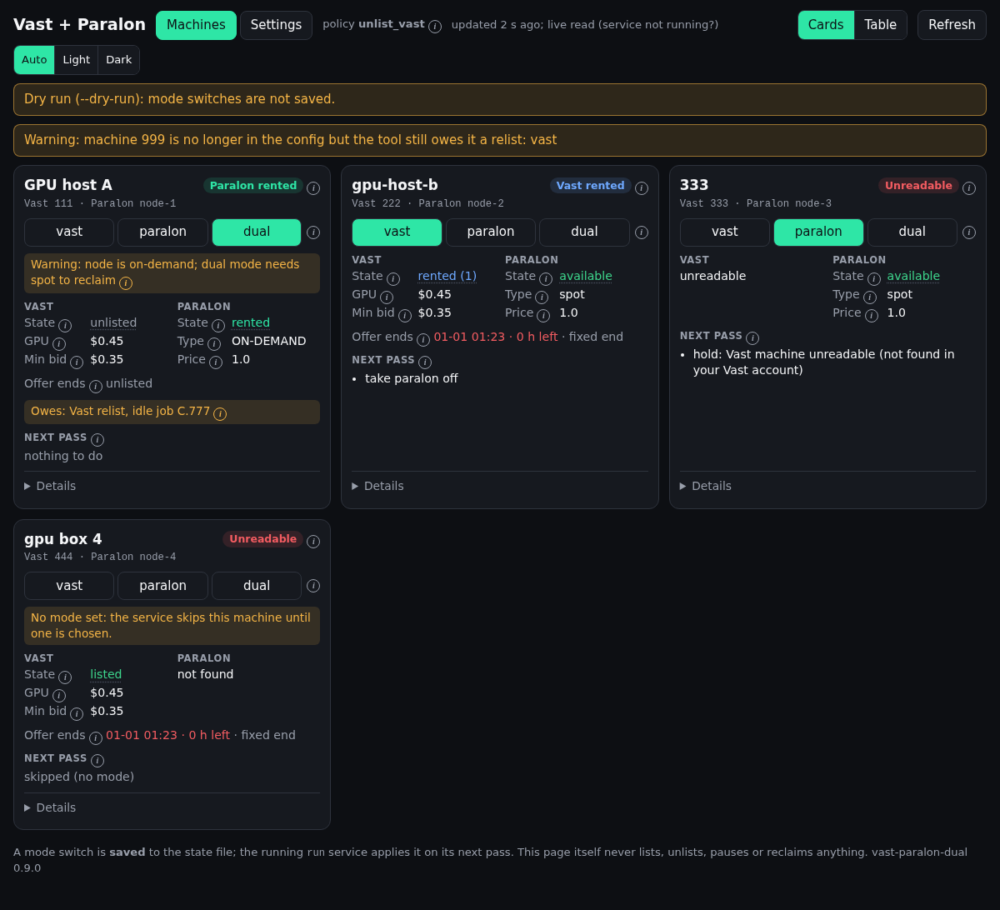
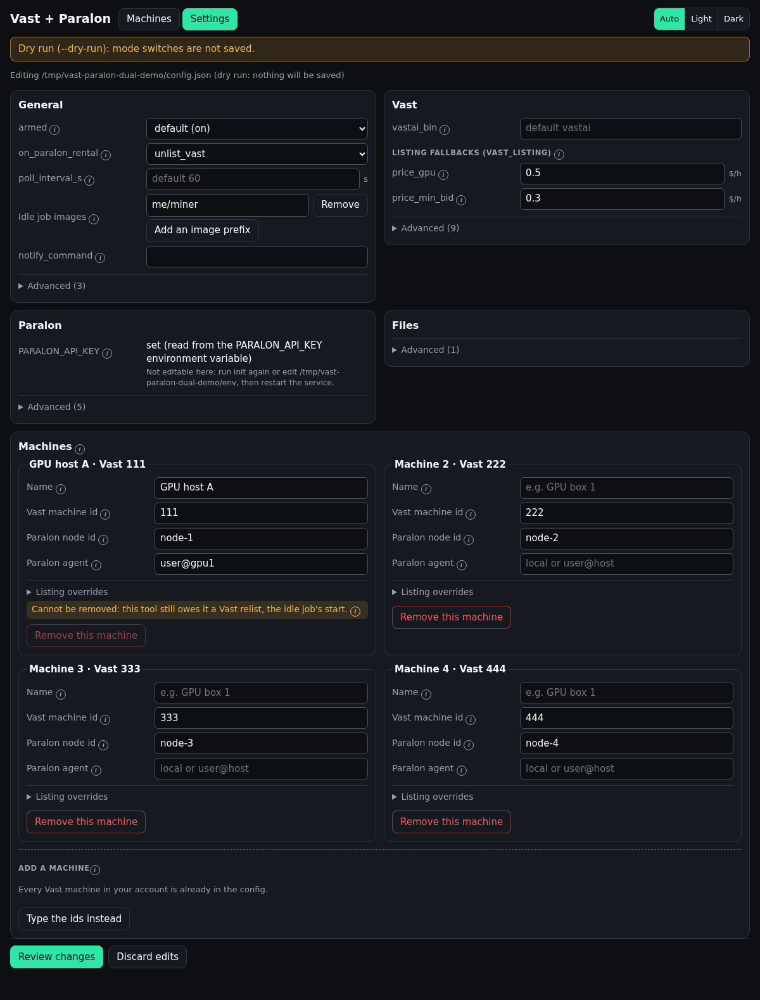

# vast-paralon-dual

> **Read this first.** This tool unlists and relists your Vast machine and
> pauses and resumes your Paralon node on its own. A mistake in its config,
> or in this tool, costs you rental income on either side. Install it, run
> `doctor`, run it unarmed (the default after `init`) for a day, read
> `status`, and only then arm it.

Rent your GPU machines on **Vast.ai** and **Paralon Cloud** at the same time,
or switch each one fully to one of them. A Vast renter always wins the GPU.

Python 3 standard library only, plus Vast's official `vastai` CLI. It never
touches the Vast daemon, its packages or its containers. On each GPU machine
it stops and starts only Paralon's agent, the containers that agent started,
and your own idle job if you name one (`idle_job_images`).

What changed in each release: [CHANGELOG.md](../CHANGELOG.md).

## Before you start

This tool switches listings; it does not install Paralon. Each GPU machine
needs, first:

1. **A Vast host that works today** (the Vast daemon running, the machine
   verified on Vast).
2. **A Paralon node with its agent running on that machine.** Create the node
   in the Paralon dashboard, set it to **spot**, and run the agent install
   command it gives you on the machine. Check the dashboard shows the node
   online and verified.
3. **A way for this tool to run `docker` on that machine** (`paralon_agent`
   in the config; **required for the protections**): run the tool on the
   machine itself (your user in the `docker` group), or give it an ssh key
   login there to a user in the `docker` group. Without it the tool still
   switches listings, but only from Vast's running count and Paralon's API
   on a 60 s pass: no renter seen from the machine's containers, no
   `docker events`, the Paralon agent and its leftovers keep running beside
   Vast renters, your idle job keeps running beside Paralon renters, and
   nothing waits for the GPU to be free before the other side is listed.
4. **Docker 29.2 or newer** on the machine. On a Vast host the NVIDIA runtime is
   in CDI mode, and older Docker cannot give the Paralon agent the GPU. Upgrade
   Docker following Vast's own host instructions.
5. **An NVIDIA CDI spec that matches the GPUs actually installed.** If the
   machine's GPUs ever change (a card added, removed or powered off), the old
   spec still lists them and the Paralon agent fails to start with
   `invoking the NVIDIA Container Runtime Hook directly ... is not supported`.
   Regenerate it:

   ```sh
   sudo nvidia-ctk cdi generate --output=/etc/cdi/nvidia.yaml
   docker restart paralon-agent
   ```

## Where to run it

Either works; the setup below is the same.

- **On a control plane** (any always-on Linux box: a server, a Raspberry Pi):
  one install manages many machines. List each machine's Vast id and Paralon
  node id in one config (`init` pairs them for you). It talks to Vast through
  the `vastai` CLI and to Paralon through its API; to switch each machine's
  Paralon agent off it runs `docker` there over ssh (`user@host`, key login),
  and it follows each machine's `docker events` over the same ssh link, so a
  Vast renter's container starting pauses Paralon within seconds.
- **On the GPU machine itself:** one install, that machine in the config
  with `"paralon_agent": "local"`. Good for a single machine with nothing else
  always on.

Either way, the Paralon agent runs on each GPU machine whenever Vast is not
renting it: that is Paralon's software doing the rental. This tool decides
where each machine is listed, and switches the agent off while Vast rents.

## Quick start

Run these as your normal user on the control plane or the GPU machine (see
above). Nothing is changed on Vast or Paralon until step 7. Step 4 is
[`doctor`](#doctor) and step 7 is [`arm`](#arm) (what each checks, their
exit codes and example output are under Commands).

```sh
# 1. Install (Python 3.8+). pipx gives each tool its own environment, out of
#    the system Python that recent Ubuntu/Debian lock down.
sudo apt install -y pipx && pipx ensurepath
export PATH="$HOME/.local/bin:$PATH"      # until you log in again
pipx install vastai
pipx install git+https://github.com/matthew351-ctrl/vast-paralon-dual.git
vastai set api-key YOUR_VAST_API_KEY

# 2. Set the Paralon key (create it in the Paralon dashboard with the
#    "My nodes" permission)
export PARALON_API_KEY=prlc_...

# 3. Pair your Vast machines with Paralon nodes and choose the policy.
#    The config it writes is NOT ARMED ("armed": false).
vast-paralon-dual init

# 4. Check the install: every row PASS or WARN, each FAIL with its fix
vast-paralon-dual doctor

# 5. Start the service, unarmed: it logs "NOT ARMED: would ..." for every
#    decision and changes nothing (runs as you, starts on boot)
vast-paralon-dual service | sudo tee /etc/systemd/system/vast-paralon-dual.service >/dev/null
sudo systemctl daemon-reload && sudo systemctl enable --now vast-paralon-dual
journalctl -u vast-paralon-dual -f

# 6. For a day: read what it would do (the web UI shows the same, under an
#    amber "Not armed" banner)
vast-paralon-dual status
vast-paralon-dual ui                      # http://127.0.0.1:8787

# 7. Arm it (doctor runs again first), then restart the service
vast-paralon-dual arm
sudo systemctl restart vast-paralon-dual
```

**From a clone instead** (no install; what the examples below use): the
same steps with `python3 vast_paralon_dual.py` in place of
`vast-paralon-dual`:

```sh
git clone https://github.com/matthew351-ctrl/vast-paralon-dual.git ~/vast-paralon-dual && cd ~/vast-paralon-dual
python3 vast_paralon_dual.py init
```

Upgrading: `pipx upgrade vast-paralon-dual` (or `git pull` in the clone),
then `doctor` and `sudo systemctl restart vast-paralon-dual`. `service`
writes the unit for whichever you use (`python -m vpdual` for a pipx
install, the script for a clone).

`init` prints the exact commands for steps 5 to 7 when it finishes, then the
`doctor` table. Set each Paralon node to **spot** in the Paralon dashboard:
only a spot rental can be reclaimed when a Vast renter arrives.

## What `init` does

- Checks that `PARALON_API_KEY` is set and that `vastai` is installed and
  logged in. If not, it says what to run.
- Reads your machines (`vastai show machines --raw`) and nodes
  (`GET /nodes`), once each.
- Asks for the policy, then which Paralon node goes with each Vast machine.
  Where a node's name matches the machine's hostname it is offered as the
  default (Enter takes it, `-` skips); otherwise Enter skips the machine.
  Then it asks how to reach Docker on each paired machine
  (`local` or `user@host`), and checks once that it can see the Paralon agent
  there. It only reads; nothing is stopped.
- Writes `~/.config/vast-paralon-dual/config.json`, the key file `env` next
  to it (mode 600, read by the service and by hand-run commands), and sets
  mode `dual` for each paired machine. Nothing changes on Vast or Paralon
  until the service runs.

For scripted installs, pass everything and it asks nothing:

```sh
python3 vast_paralon_dual.py init --policy unlist_vast \
    --pair 12345=NODE_ID --pair 12346=OTHER_NODE_ID \
    --agent 12345=local --agent 12346=you@gpu-machine-2 [--force]
```

Other options: `--price-gpu`, `--price-min-bid`, `--duration` (fallback
listing terms), `--mode vast|paralon|dual`, `--state-file`, `--vastai-bin`.
Use `-c PATH` before `init` for a different config path; `init` then prints
commands that carry it.

## Commands

```
vast_paralon_dual.py [-c CONFIG] init [options]
vast_paralon_dual.py [-c CONFIG] doctor
vast_paralon_dual.py [-c CONFIG] arm [--skip-doctor]
vast_paralon_dual.py [-c CONFIG] status [--json] [VAST_MACHINE_ID]
vast_paralon_dual.py [-c CONFIG] [--dry-run] mode vast|paralon|dual [VAST_MACHINE_ID]
vast_paralon_dual.py [-c CONFIG] [--dry-run] [-v] run [--skip-doctor]
vast_paralon_dual.py [-c CONFIG] [--dry-run] ui [--host HOST] [--port PORT]
vast_paralon_dual.py [-c CONFIG] service
```

### `doctor`

Checks the install and prints one PASS / WARN / FAIL row per check, each
FAIL or WARN with its fix. **Exit 0** when nothing FAILs (WARNs allowed),
**exit 1** on any FAIL. It changes nothing on Vast or Paralon; the only
thing it writes is a temp file, created in the state directory and removed
at once, to prove that directory is really writable.

What it checks: Python >= 3.8; `vastai` found, its version (>= 1.3.0; newer
than the tested one is a WARN) and its login; the Paralon key (environment,
or the `env` file at mode 600) and one `GET /nodes`; the config; every
`vast_machine_id` in `show machines` and every `paralon_node_id` in
`GET /nodes`; `docker ps` on each `paralon_agent` (over `ssh -o
BatchMode=yes` for `user@host`); a relist price per machine (WARN when the
config fallback would be used); the state file (a real write probe: a
read-only mount or a full disk FAILs even as root) and its `.lock`; the
systemd unit (WARN only).

```
$ vast-paralon-dual doctor
python + vastai:
  PASS  python               Python 3.12.3
  PASS  vastai found         /home/you/.local/bin/vastai
  PASS  vastai version       vastai 1.3.0
  PASS  vastai logged in     `vastai show user` works
Paralon key:
  PASS  key present          PARALON_API_KEY from the environment
  PASS  GET /nodes           1 node(s) readable
config:
  PASS  loads and validates  /home/you/.config/vast-paralon-dual/config.json: 1 machine(s)
machines and nodes:
  PASS  vast 111             in `show machines`
  PASS  node node-1          in GET /nodes
Paralon agents:
  PASS  me@gpu1              ssh (BatchMode) + docker ps works (1 container(s))
relist prices:
  PASS  machine 111          terms are saved at unlist; config fallback present
state file:
  PASS  writable             /home/you/.local/state/vast-paralon-dual/state.json
  PASS  .lock                can be taken
service:
  WARN  installed            vast-paralon-dual.service is not installed
        fix: see `service` (after a day unarmed and arming)
0 fail, 1 warn, 13 pass
```

### `arm`

Lets `run` make changes: sets `"armed": true` in the config (the old file
is kept as a backup). It runs `doctor` first and **refuses (exit 2)** on a
FAIL in the first five groups (vastai, the Paralon key, the config, the
ids, Docker on each machine), the same FAILs that stop `run` from starting;
`--skip-doctor` arms anyway. **Exit 0** when armed, or already armed
(nothing changed). The service reads the config when it starts, so restart
it to apply.

```
$ vast-paralon-dual arm
...                                  (the doctor table, as above)
armed (old config kept as config.json.bak-20261108-125223). Restart the service to apply: sudo systemctl restart vast-paralon-dual

$ vast-paralon-dual arm              # with the Paralon key missing
...
  FAIL  key present          no PARALON_API_KEY in the environment or /home/you/.config/vast-paralon-dual/env
        fix: run `init`, or write PARALON_API_KEY=prlc_... to that file (chmod 600)
...
not armed: fix the FAIL rows above first (or --skip-doctor)
```

### The other commands

- `status`: per machine, both sides, owed relists, whether the Paralon agent
  is running, the listing a relist would use, what the next pass would do and
  the last decisions. Writes nothing. `--json`: the same as JSON plus the
  tool's, Python's and `vastai`'s versions, the `doctor` summary and the
  last 10 decisions per machine -- the file to attach to a bug report
  (see Reporting a problem).
- `mode`: saves the mode for one machine (or all) and applies it once. The
  running service re-reads the state file at the start of every pass, so it
  follows the change from its next pass; a lock file next to the state file
  stops the two acting on a machine at the same moment.
  - `dual`: listed on both (the rules below).
  - `vast`: Paralon paused, Vast listed.
  - `paralon`: Vast unlisted, Paralon available once no Vast renter is
    running (unlisting never evicts a renter).
- `run`: the watcher (what the service runs). Machines with no mode are
  skipped until one is set. It makes the `doctor` checks first and refuses
  to start (exit 2) on a FAIL in the first five groups (vastai, the
  Paralon key, the config, the ids, Docker on each machine);
  `--skip-doctor` starts anyway. Unarmed, it makes every decision and logs
  it as `NOT ARMED: would ...`, but lists, unlists, pauses, reclaims, stops
  and starts nothing.
- `service`: prints the systemd unit filled in for your account, Python and
  paths (template: `systemd/vast-paralon-dual.service`).
- `--dry-run`: logs what it would do; no API write, no state-file write.

## Web UI

```sh
python3 vast_paralon_dual.py ui            # then open http://127.0.0.1:8787
```

A small page served by the tool itself (standard library only, nothing
loaded from the internet). It follows the system's light/dark setting, or
the Auto / Light / Dark switch in its header (remembered in the browser);
the colours follow Paralon Cloud's own app theme. Machines show as
a grid of cards, as many side by side as the screen fits (one column on a
phone), or as a table with one row per machine. Each card is titled by the
machine's name (see `machines[].name`) and shows its status at a glance
(Vast rented, Paralon rented, free on both, unreadable...), the mode, both
sides, what this tool owes (took off) and what the next pass would do; its
"Details" hold the Paralon agent and the machine's containers, the relist
terms and the last 5 decisions. Every term has an (i) that explains it, on
hover, keyboard focus or tap. It refreshes every 15 s. It is the
same data as `status` (`GET /api/status` serves it as JSON) and, like
`status`, it writes nothing to Vast or Paralon.



Where the data comes from: the running `run` service writes it after every
pass, from that pass's own reads, to `status.json` next to the state file,
and the page serves that file while it is younger than three
`poll_interval_s`; the header says "from the service, N s ago". So an open
page, or several, costs no `vastai`, Paralon or SSH call at all. If the
service is not running (or no machine has a mode yet), the page reads both
sides itself, as `status` does, and says "live read (service not
running?)". A mode you switch shows on the page at once; the service
applies it on its next pass.

Each machine has a vast / paralon / dual switch. After a confirm, the mode is
**saved** to the state file, as `mode` does, and nothing else: the running
`run` service applies it on its next pass (within `poll_interval_s`). The
page never runs a pass of its own, so the service stays the only process
acting on Vast and Paralon. If the service is not running, nothing changes
until it starts. With `--dry-run` nothing is saved.

A **Settings** tab edits the config file: every setting with its unit and
default, the shared Vast listing fallbacks, and the machines (add, edit,
remove; name, ids, `paralon_agent`, listing overrides). "Review changes"
checks the edit with the same validator `status` and `run` use, marks each
problem beside its field and shows old against new before you confirm.
Nothing is saved while any check fails. A save keeps your `_` comments and
custom keys, the key order and the indent; the old file is kept as
`config.json.bak-<date>-<time>` (the last 10), and the new one is written
atomically with mode 600. It refuses to remove a machine the tool still owes
something (a relist, an un-pause, a start), to change its Paralon node while
an un-pause is owed, and to move `state_file` while anything is owed.
The running service reads the config only when it starts, so restart it to
apply a saved change (`sudo systemctl restart vast-paralon-dual`); the page
itself uses the new config at once. The Paralon API key is never shown or
sent: the page says only whether it is set and where it is read from; change
it with `init` or by editing the `env` file next to the config. With
`--dry-run` the page shows the changes and saves nothing.



Both screenshots are the synthetic machines of `tests/status_scenario.py`
served with `--dry-run`; the ids are not real ones.

It listens on **127.0.0.1 only** by default (port 8787). Without a login,
anyone who can open the page can switch modes and edit the config. To
require one, set a password in the environment of the `ui` process:

```sh
VPDUAL_UI_PASSWORD='a long passphrase' python3 vast_paralon_dual.py ui
```

The page then asks for it (5 wrong tries lock that address out for 5
minutes), and a login lasts 12 hours or until `ui` restarts; Log out ends it.
Every `/api/*` call needs the login, and a switch or save still needs the
page's token. The page is plain HTTP, so the password crosses the network
unencrypted when it is not on loopback. To use it from your phone or
another computer, prefer an SSH tunnel:

```sh
ssh -L 8787:127.0.0.1:8787 you@gpu-host     # then http://127.0.0.1:8787 there
```

`--host 0.0.0.0` (or a LAN address) serves it to your whole network and
prints a warning saying so; only do that on a network you trust, and open it
by IP address (other host names are refused, which stops DNS-rebinding
pages). Since 0.7.0 it **refuses to start** off loopback without
`VPDUAL_UI_PASSWORD`, unless you pass `--no-login` to accept that anyone who
can reach it can use it. A switch or a save needs a random token from the page, changed each
time `ui` starts, and is refused from any other web site.

## How it decides

**The machine decides, Vast's count is a hint.** For every machine with
`paralon_agent`, each pass also reads the machine itself in one command:
`docker ps` (which containers run) and `nvidia-smi` (GPU compute processes and
memory in use). A Vast renter is running when Vast's running count says so
**or** a Vast rental container (`C.<id>`) runs on the machine -- the count can
lag a container that already runs, and a new renter's container may still be
pulling its image. Paralon is made available again only when the machine shows
no Vast container, the Paralon agent running and the node online.

**Containers starting act at once** (`docker_events`, on by default): the
tool follows `docker events` on each machine (locally or over the ssh link).
When a non-Paralon container starts -- anything but Paralon's own containers,
this tool's pin and your `idle_job_images` -- every available Paralon node on
that machine is paused immediately, and a full pass follows within seconds
(it stops the agent and reads Vast). When a **Paralon rental** container
starts (Paralon labels a tenant's container `paralon.type=rental`; its agent,
benchmarks and inference workers are not rentals), the tool at once unlists
Vast (dual mode with `unlist_vast`, unless a Vast renter already runs) and
stops your idle job, instead of waiting up to a minute for the API to show
the rental.

Each pass (every 60 s by default, every `fast_poll_s` = 5 s while a machine
is recovering, see rule 3) reads both sides first: one
`vastai show machines --raw` and one `GET /nodes`, shared by all machines. If
either read fails, it does nothing and logs `hold`. A machine missing from a
read holds on its own.

1. **Vast renter running** (any mode): Paralon is set `available: false`. If
   Paralon also has a running rental on a spot node, it is reclaimed (the
   Paralon renter gets 2 minutes' notice). An on-demand rental cannot be
   reclaimed: the tool warns.
   Then the machine's **Paralon agent is stopped**, and after it any
   container it started that is still running (inference, model download,
   benchmark) is killed. The agent goes first (2 s grace), so it is gone
   before the containers it watches die; the leftovers are killed outright
   because Paralon's inference worker ignores a polite stop and would hold
   the renter's GPU memory for Docker's whole stop timeout. While a Paralon rental is being reclaimed the agent stays
   up, because it runs the reclaim; it is stopped once the rental has ended.
   A Paralon rental's container and Vast's containers are never touched. If
   Docker restarts and brings the agent back during the rental, the next pass
   stops it again.
   Every pass (any mode, rented or not) it also keeps Paralon's Jupyter image
   pinned: one `docker create`d container named `vpdual-pin-jupyter-<image id>`,
   never started. When Paralon publishes a new image, the next pass pins the
   new one and removes the old pin. It never pulls: if the image is not on the
   machine yet (the Paralon agent downloads it when it starts), nothing happens
   until it is.
   **A stored Vast instance keeps Paralon paused**, spot or on-demand (since
   v0.5.0; before, on-demand only). A renter's stopped instance (Vast's
   resident count above its running count) can resume at any moment, and
   unlisting Vast does not stop a resume: beside a spot rental the two would
   share the GPU for the 2-minute reclaim notice, beside an on-demand rental
   until one ends. The node stays registered (`available: false`, never
   deleted) and is made available again once nothing is stored. If Paralon
   is already rented when an instance is stored, the rental cannot be
   paused out: the tool warns, keeps the node paused so no new rental
   follows, and a resume is handled as above (reclaim). Vast does not count
   your own default job in either count.
2. **Paralon rented, no Vast renter** (dual mode): per `on_paralon_rental`.
   "Rented" is the API's `rented` **or** a Paralon rental container running
   on the machine (the API can lag it by a minute):
   - `unlist_vast` (the default): Vast is unlisted until the Paralon rental
     ends, so Vast cannot start a renter on the same GPU. With
     `docker_events` the unlist is sent the moment the rental's container
     starts, through the same path as a pass (flag and listing terms saved
     first). If the next passes show no rental after all (the container
     exited and the API never showed one), Vast is relisted as below.
   - `keep_vast_listed`: Vast stays listed. Paralon is interruptible fill; a
     Vast booking triggers rule 1, and the Vast renter waits for the spot
     reclaim (Paralon gives its renter 2 minutes' notice).
3. **Rental ended**: the tool relists only what it took off itself, and
   starts the Paralon agent only if it stopped it. After a Vast rental the
   machine is **recovering**: passes run every `fast_poll_s` (5 s) until the
   GPU is actually free (no compute process, at most `gpu_free_mib` in use),
   then the agent is started, then it waits until the node shows online on
   Paralon (a fresh `GET /nodes` once a minute, as Paralon's docs advise),
   and only then sets it available. These flags live in the
   state file, saved before each unlist/pause/stop and cleared only when a
   later read shows the side back, so a restart never loses one. A side you
   unlist or pause by hand, or an agent you stop by hand, is left alone. The
   node shows offline on Paralon while its agent is stopped, so it is made
   available again on the pass after the agent reconnects.
   After a **Paralon** rental (for a machine with `paralon_agent`), Vast is
   relisted only once no Paralon rental container runs on the machine and
   the GPU is free (no compute process, at most `gpu_free_mib` in use); until
   then the pass logs `hold: not relisting Vast yet -- ...` and passes run
   every `fast_poll_s`. An unreadable machine holds too. The agent's own
   benchmark or inference worker does not hold it (it may run as long as the
   agent does, and rule 1 kills it the moment a Vast renter arrives). A
   machine without `paralon_agent` is relisted as soon as the API shows the
   rental ended.

### Your idle job

`idle_job_images` names your own idle job (a miner, say): never a renter.
On a machine with `paralon_agent` it also **never runs under a Paralon
rental** (since v0.5.0). While a Paralon rental runs (the API, or a rental
container on the machine) and no Vast renter does, the tool stops it, and
starts it again once the rental is over -- only what it stopped itself (the
`idle_job` list in the state file, saved before the stop and cleared only
when a later read shows the job back).

- **A Vast default job** (a running `C.<id>` container whose image matches):
  stopped and started through Vast, because Vast's daemon restarts a default
  job it believes should run. The tool reads `vastai show instances --raw`,
  takes the instances whose `machine_id` is this machine and whose
  `image_uuid` starts with an `idle_job_images` prefix, and runs `vastai stop
  instance <id>` for each whose `intended_status` is `running`. To start it
  again: `vastai start instance <id>` while its `intended_status` is not
  `running`; it is back once it reads `running`.
- **A plain Docker container** you run yourself (any other name):
  `docker stop` / `docker start` on the machine.

The order after a Paralon rental: once the rental's container is gone and
the GPU is free, the pass relists Vast first and then starts the idle job.
The idle job can never hold the relist back: it starts after the relist, and
a running idle job counts as a free GPU (a Vast renter's arrival stops a
default job anyway). A relist that is held for another reason (no saved
price, a failed write) does not hold the idle job.

Switching modes does not end a rental already running on either side.

### Relist prices

Just before it unlists a Vast machine, the tool saves that machine's current
listing from the same read: GPU price, min bid, disk price, upload and
download bandwidth prices, minimum GPU chunk, reserved discount rate, volume
offer (or `--vol_size 0` when there is none, so Vast does not create one),
and the offer end. The relist passes all of them back (`vastai list machine`
resets any term it is not given). A rolling offer (`--duration`, extended
daily by Vast) is relisted as rolling; a fixed end date is relisted as that
date, or, if it has passed by then, with the config's `duration`.

A relist or unlist is checked two ways: the CLI is run with `--raw` and its
JSON reply must say `success`, because `vastai` exits 0 and prints only a
message when the server refuses; and the "owed" flag is cleared only when
the next read shows the side back. If the Paralon node disappears from your
account while a Vast relist is owed, the relist still happens. A relist that
Vast keeps refusing (an unverified or de-listed machine) is sent on 5 passes,
then once every 10 minutes, with one warning in the log, until the read
shows the machine listed.

Config prices are only a fallback, for terms nothing was saved for, for
example a machine you unlisted by hand before installing and then switch to
`mode vast`. If there is neither a saved nor a config GPU price and min bid,
the tool does not list the machine and logs `hold: cannot relist Vast: ...`.

## Config

`init` writes it. Format (see `config.example.json`):

```json
{
  "on_paralon_rental": "unlist_vast",
  "machines": [
    {"vast_machine_id": 12345, "paralon_node_id": "node-id",
     "paralon_agent": "local", "name": "GPU box 1"},
    {"vast_machine_id": 12346, "paralon_node_id": "other-node-id",
     "paralon_agent": "you@gpu-machine-2",
     "vast_listing": {"price_gpu": 0.60, "price_min_bid": 0.45}}
  ],
  "vast_listing": {"price_gpu": 0.40, "price_min_bid": 0.30, "duration": "14 days"}
}
```

| key | meaning |
| --- | --- |
| `on_paralon_rental` | `unlist_vast` (default) or `keep_vast_listed` |
| `armed` | `false` = every decision is logged as `NOT ARMED: would ...` and nothing is changed on Vast, Paralon or Docker (`init` writes `false`); `true` = act. Left out = `true`, so a config from before v0.8.0 keeps working. `arm` or the Settings tab sets it |
| `notify_command` | optional shell command run for warnings and confirmed side changes (see Notifications) |
| `machines` | list of `{vast_machine_id, paralon_node_id}`, each with an optional `paralon_agent` and an optional `vast_listing` that overrides the top-level one |
| `machines[].agent_control` | how the Paralon agent is stopped and started (v0.8.0): `docker` (default: its container), `systemd` (`systemctl --user stop` / `start` of `paralon_agent_unit` over the same local / ssh path; the user needs a systemd instance, `loginctl enable-linger`; the containers the agent started are still killed with `docker`), or `none` (the agent is never stopped, started or waited for; the other protections that use `paralon_agent` stay) |
| `machines[].paralon_agent_unit` | the agent's systemd `--user` unit, e.g. `paralon-agent.service`; required with `agent_control: "systemd"` |
| `machines[].name` | optional label for people (up to 64 characters), shown by `status` and the web UI. Left out, the hostname Vast reports for the machine is shown, else the Vast machine id. Only a label: commands and the web UI's switch still use the Vast machine id |
| `machines[].paralon_agent` | how to run `docker` on that machine: `local`, or `user@host` for ssh (key login, `BatchMode`; the user must be in the `docker` group). **Required for the protections**: renter detection from the machine's own containers, `docker_events`, stopping Paralon's agent and its leftovers during Vast rentals, stopping your idle job during Paralon rentals, and the GPU-free waits before the agent starts and before Vast is relisted. Left out, the tool has only Vast's running count and Paralon's API on a 60 s pass |
| `vast_listing` | optional fallback listing terms (see Relist prices); keys map to `vastai list machine` flags: `price_gpu`, `price_min_bid`, `price_disk`, `price_inetu`, `price_inetd`, `discount_rate`, `min_chunk`, `end_date` or `duration` (not both), `vol_size`, `vol_price` |
| `state_file` | default `~/.local/state/vast-paralon-dual/state.json` |
| `poll_interval_s` | seconds between passes (default 60) |
| `paralon_min_get_interval_s` | minimum seconds between `GET /nodes` while nothing is happening (default 120; once a minute while recovering or rented) |
| `paralon_max_calls_per_min` | hard cap on Paralon calls (default 6; 4 before v0.4.7, when a 30 s burst read could fill the minute and hold a write back by a minute or more) |
| `reclaim_retry_s` | do not repeat a reclaim sooner than this (default 300) |
| `vastai_bin` | path to `vastai` (`init` writes the full path) |
| `docker_events` | follow `docker events` on each machine with `paralon_agent`: pause Paralon the moment a non-Paralon container starts, and unlist Vast (`unlist_vast`) and stop your idle job the moment a Paralon rental container starts (default `true`) |
| `gpu_free_mib` | the GPU counts as free with no compute process and at most this much memory in use (default 500); used before the agent starts after a Vast rental and before Vast is relisted after a Paralon rental |
| `fast_poll_s` | seconds between passes while a machine recovers after a Vast rental, or waits for the GPU before a Vast relist (default 5) |
| `idle_job_images` | image name prefixes of your own idle job (a miner, say) on the machine: never a renter, its GPU use does not block the agent's start, and (with `paralon_agent`) it is stopped while a Paralon rental runs and started again after -- a Vast default job through `vastai stop/start instance`, a plain container through Docker (default none) |

The old single-machine format (`vast_machine_id` and `paralon_node_id` at the
top level) still loads. An old (v0.1) state file is carried over only when
the config still has exactly one machine; with more, its mode is dropped
(logged) and you run `mode ...` again.

Notes: `current_rentals_running` is Vast's count -- a hint next to the
machine's own reading -- so an interruptible (bid) renter counts as a Vast
renter, as it should. Hand-run `status` or `mode`
commands make their own Paralon calls outside the service's per-minute
budget; `status` is one `GET /nodes`.

The key comes from `PARALON_API_KEY`, or else from the `env` file next to
the config. It is never logged.

## Notifications

Set `notify_command` to a shell command and it runs for every WARNING-level
decision (a hold, a failed write, a relist Vast will not accept) and every
confirmed side change: a read showing Vast listed or unlisted, or the
Paralon node available or paused, where the last read showed the opposite
(whoever made the change). The message is on its stdin; the environment adds
`VPDUAL_MACHINE` (the Vast machine id), `VPDUAL_LEVEL` (`WARNING` or `INFO`)
and `VPDUAL_EVENT` (e.g. `vast_unlisted`, `paralon_available`,
`relist_held`).

It runs as the service's user, with a 20 s limit, on its own thread: a slow
or failing command never holds a pass (a failure is logged at most once per
10 min). At most one notification per machine per event kind per 10 min; a
held relist (no price to relist with) is repeated every hour until it
clears. Nothing is sent by a dry run, `status` or the web UI.

ntfy (a topic on ntfy.sh or your own server):

```json
"notify_command": "curl -fsS -H \"Title: vast-paralon-dual $VPDUAL_EVENT\" -d @- https://ntfy.sh/YOUR-PRIVATE-TOPIC"
```

Telegram (a bot token and your chat id; keep the config readable by you only
if it holds the token, or put the command in a script under `~/bin`):

```json
"notify_command": "curl -fsS https://api.telegram.org/botYOUR_BOT_TOKEN/sendMessage -d chat_id=YOUR_CHAT_ID --data-urlencode text@-"
```

Discord (a channel webhook; the URL is the secret, so keep it out of a
shared config the same way as the Telegram token). `python3` turns the
message into JSON, so quotes and line breaks in it arrive intact:

```json
"notify_command": "python3 -c 'import json,sys; print(json.dumps({\"content\": sys.stdin.read().strip()}))' | curl -fsS -H \"Content-Type: application/json\" -d @- https://discord.com/api/webhooks/YOUR/WEBHOOK"
```

Mail (any `mail`/`mailx` with a working local MTA):

```json
"notify_command": "mail -s \"vast-paralon-dual: machine $VPDUAL_MACHINE $VPDUAL_EVENT\" you@example.com"
```

## Service

The service runs as the user who installed it, so it uses that user's
`vastai` login and the files under `~/.config` and `~/.local/state`.
`service` fills in the user and paths; to write the unit by hand, copy
`systemd/vast-paralon-dual.service` and replace the `@...@` placeholders as
its header explains. If `docker_events` is on, that user must be in the
`docker` group.

systemd starts the service with a minimal `PATH`, so `vastai_bin` must be a
full path (`init` writes one; `run` warns if it cannot resolve the name). A
service with no mode set keeps running and warns until you run `mode ...`;
every pass re-reads the state file, so it picks the mode up without a
restart.

### Stopping it for good, or removing it

First run `mode vast` for each machine (or once with no machine id, for
all). It relists on Vast what the tool unlisted, pauses Paralon, and starts
your idle job if the tool stopped it and no Paralon rental is running. A
machine the tool unlisted on Vast **stays unlisted while the service is
stopped**: the unit's `Restart=always` covers a crash, not a deliberate
`systemctl stop`. Check with `status` that nothing is owed, then:

```sh
python3 vast_paralon_dual.py mode vast
python3 vast_paralon_dual.py status        # "took off (owed)" all false
sudo systemctl disable --now vast-paralon-dual
sudo rm /etc/systemd/system/vast-paralon-dual.service && sudo systemctl daemon-reload
rm -r ~/.config/vast-paralon-dual ~/.local/state/vast-paralon-dual ~/vast-paralon-dual
```

If a Paralon rental is still running, `mode vast` relists Vast at once (a
Vast booking then reclaims a spot rental) but your idle job stays stopped
until the rental ends; and in the seconds after a rental, while its
container tears down, the relist waits for the GPU. Leave the service
running until `status` shows nothing owed. Removing the tool leaves
the Paralon agent and Vast's software as they are; the `vpdual-pin-jupyter-*`
container can be removed with `docker rm`.

## API use

- Paralon (`https://paraloncloud.com/api/v1`, `Authorization: Bearer prlc_...`):
  `GET /nodes`, `PATCH /nodes/{id}` with `{"available": true|false}`,
  `POST /nodes/{id}/reclaim` (spot only). One `GET /nodes` every 2 minutes
  (shared by all machines); once a minute while one of its nodes is rented or
  an ON-DEMAND node waits available (a late rental container is seen only
  through the API, and on-demand cannot be reclaimed);
  every 30 s for 4 minutes at a critical moment (a write that landed, a
  reclaim, a Vast renter or a Paralon container starting on a machine) and
  while a machine recovers after a Vast rental; at most 6 calls a minute; exponential
  back-off on every HTTP error and on network errors. No pause write is sent
  for a node that reads OFFLINE (it cannot be rented). With many machines changing in the same
  minute, writes beyond the limit wait for a later pass.
- Docker on each GPU machine (only with `paralon_agent`; directly, or one
  `ssh -o BatchMode=yes user@host docker ...` per command):
  each pass, one read of the machine (`docker ps -a --no-trunc --format ...`
  and `nvidia-smi`); on a Vast arrival `docker stop -t 2 <id>` for the agent,
  then `docker kill <id>` for the containers it started; `docker start <id>`
  for the agent; `docker stop -t 2 <id>` / `docker start <id>` for your
  idle job when it is a plain container; and `docker events` (one
  long-lived stream per machine; it prints each started container's name,
  image and `paralon.type` label). The agent is found by its image (`ghcr.io/paraloncloud/agent`),
  because it renames its own container when it updates. Each pass also runs
  one short shell command for the Jupyter pin: `docker image inspect`, then
  `docker create` only if the pin is missing, and `docker rm` of older pins.
  While the agent is stopped, once every `jupyter_refresh_s` (default 3600) a
  low-priority `docker pull -q ghcr.io/paraloncloud/jupyter:latest` on a
  background thread keeps the image current, so a node is not left "digest not
  approved" when Paralon publishes a new image during a Vast rental.
- Vast (`vastai` CLI, checked against version 1.3.0):
  `vastai show machines --raw`, `vastai list machine <id> --price_gpu ...
  --price_min_bid ... --price_disk ... --price_inetu ... --price_inetd ...
  --end_date ...`, `vastai unlist machine <id>`. With `idle_job_images`
  and a Vast default job only: `vastai show instances --raw` (while a
  Paralon rental runs beside your job, and when its start is owed), `vastai
  stop instance <id>` and `vastai start instance <id>` for that job --
  never a renter's instance. These two exit 0 whatever the server says, so
  the tool checks for their "stopping/starting instance <id>." reply.

## Known limits

- **One Vast machine <-> one Paralon node.** Each pair is one GPU machine;
  a machine split across several Paralon nodes, or one node over several
  Vast machines, is not supported.
- **A partial Vast rental counts as rented.** A renter on some of a
  machine's GPUs pauses the Paralon node for the whole machine.
- **Your idle job must be a Docker container** (or a Vast default job).
  The Paralon agent can be a container or a systemd `--user` unit
  (`agent_control`); an agent run any other way cannot be managed: set
  `"agent_control": "none"` for that machine.
- On a Vast host, the Paralon agent needs **Docker 29.2 or newer** to see the
  GPU. Upgrade using Vast's own host instructions; this tool does not.
- Since 2026-10-26 Paralon runs no inference or render jobs on **spot**
  nodes; an on-demand node can still get them, and either can get a
  verification benchmark (e.g. after a rental). The agent is still stopped
  during Vast rentals, so nothing of Paralon's can start beside the renter; in the seconds before the pass that stops
  it, a Paralon inference worker can still hold GPU memory beside it.
- **Container DNS.** Paralon's containers use Docker's default DNS. If your
  `daemon.json` names a LAN resolver that a firewall blocks for containers,
  every lookup inside a Paralon container waits for the timeout and the
  rental's Jupyter URL stays unreachable for about a minute (seen on our
  machines). Check: `docker run --rm --entrypoint getent
  ghcr.io/paraloncloud/jupyter:latest hosts paraloncloud.com` should answer
  in milliseconds.
- A node whose benchmark was killed beside a Vast renter may show
  verification "failed". Paralon retries about every 31 minutes; it passes
  once a retry runs while no Vast renter is on the machine.
- The Jupyter pin needs `paralon_agent` (it uses the same Docker access).
  Without it, Vast's image cleanup can delete Paralon's Jupyter image and the
  node shows "not ready" until the Paralon agent downloads it again, which it
  does only when it starts.
- **Without `paralon_agent` the gaps are a minute wide.** Vast is unlisted
  only once a pass sees `rented` on Paralon's API (a Vast booking in that
  minute shares the GPU until the spot reclaim ends the Paralon rental, 2
  minutes later), your idle job is not stopped at all, and Vast is relisted
  without waiting for the GPU.
- A Paralon rental is told apart from Paralon's other containers by the
  `paralon.type=rental` label Paralon puts on it. If Paralon stops labelling
  rentals, the immediate unlist and idle-job stop fall back to the next pass
  that sees `rented` on the API.
- A stored Vast instance keeps the node paused for as long as it is stored;
  a renter can leave a stopped instance for days. That is Paralon time given
  up so a resume never lands on a Paralon renter.
- With `keep_vast_listed`, Vast stays listed during a Paralon rental by
  design: a Vast booking reclaims the spot rental, and the two share the GPU
  for the 2-minute notice.
- Stopping a Vast default job takes Vast a few seconds; the immediate stop on
  a rental container starting narrows that window but cannot close it.

## Reporting a problem

This tool is community-maintained. It is **not** made, endorsed or supported
by Paralon or by Vast.ai: report its problems here (GitHub issues), not to
them.

Attach:

1. `vast-paralon-dual status --json > status.json` (from a clone:
   `python3 vast_paralon_dual.py status --json`). It holds the versions,
   the `doctor` summary, both sides as the tool reads them, what the next
   pass would do and the last 10 decisions per machine. The Paralon key is
   never in it and every ssh `paralon_agent` (`user@host`) reads
   `user@host`; your machine ids, node ids and machine names are in it --
   edit them out if you prefer.
2. The log around the problem: `journalctl -u vast-paralon-dual --since
   "1 hour ago"` (read it first: it has your machine ids and, for an ssh
   error, your `user@host`).
3. What you expected, and what happened instead.

Never post your config's `env` file, your Paralon key or your Vast API key.

## Compliance

Dual-listing is allowed: Vast's hosting agreement is non-exclusive. Do **not**
contact or solicit Vast customers to move to Paralon (non-circumvention). Do
not stop, mask or modify Vast's software, and do not bypass its apt pins.
This tool stops only Paralon's agent and its containers, never Vast's.

## Possible future work

A price floor (pause Paralon below a set price). If Paralon
adds an inference/benchmark switch for paused nodes, stopping the agent will
no longer be needed.

## Tests

```sh
python3 -m unittest discover -s tests -t tests
```

## License

MIT, see `LICENSE`.
